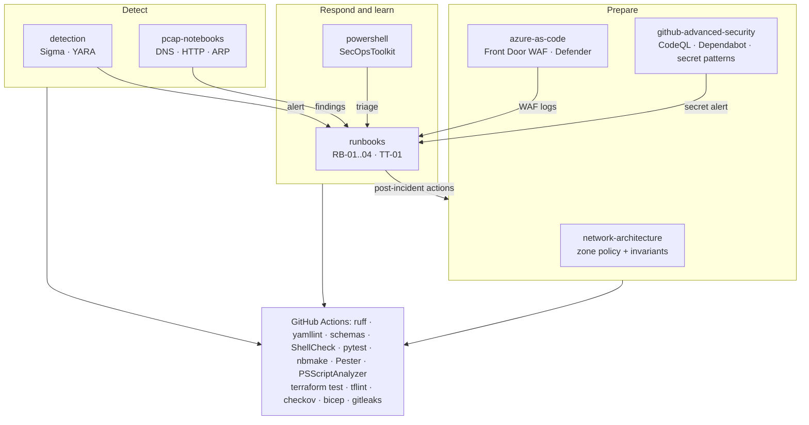

# secops-playbooks


Defensive security operations reference by DCtech.: incident response runbooks with a tabletop exercise, GitHub Advanced Security configuration, Azure Front Door WAF and Defender for Cloud as code, network-forensics notebooks on public captures, Sigma/YARA detections, a documented multi-site firewall design and a PowerShell triage module. Every part has an automated check in CI.

> **Defensive only, synthetic data only.** No malware, no exploits, no offensive tooling. The organization in the examples ("Example Co.") is fictional, addresses are RFC 1918 / RFC 5737 and domains are `example.com`. Malware detection is tested with the EICAR test string and benign files; packet analysis uses public Wireshark sample captures that are downloaded and sha256-verified, not redistributed. Nothing here contains DCtech. or client incident data, and nothing has been deployed to a real environment.

## The problem

How to handle a leaked token, which WAF rules are on and what the firewall should allow usually live in someone's head. Here they are files that can be reviewed, versioned and tested, so CI catches a dead runbook link, a detection that stopped firing, or a WAF default that is no longer "block".

## What is inside

| Area | Folder | Proof in CI |
|---|---|---|
| Incident response: 4 runbooks (phishing, leaked secret, ransomware, WAF attack), tabletop exercise, report templates | [`runbooks`](runbooks) | section structure, links and "no personal data" lint across all Markdown |
| GitHub Advanced Security: CodeQL workflow + config, Dependabot, custom secret scanning patterns, enablement script | [`github-advanced-security`](github-advanced-security), [`.github`](.github) | JSON-schema validation, pattern tests with generated tokens, ShellCheck, dry-run test |
| Azure Front Door WAF (DRS 2.1, bot rules, rate limit) and Defender for Cloud, in Terraform and Bicep | [`azure-as-code`](azure-as-code) | `terraform validate` + 9 mock-provider tests, tflint, checkov, Bicep build/lint with warnings as errors and a negative fixture |
| Network forensics notebooks on public PCAPs (DNS, HTTP, ARP storm) | [`pcap-notebooks`](pcap-notebooks) | unit tests on a synthetic capture; notebooks executed by nbmake with assertions on findings |
| Detection: Sigma (PowerShell encoded command, certutil download, EICAR file) and YARA (EICAR, canary document) | [`detection`](detection) | pySigma validators, rules converted to SQL and run against labelled events; YARA matched against EICAR and benign files |
| Multi-site zone-based firewall design (UniFi-style, fictional) | [`network-architecture`](network-architecture) | policy invariants (default drop, guest isolation, IoT no internet, admin-only management, no overlaps, placeholder WANs) |
| PowerShell triage module: IOC hash match, timeline merge, brute-force finder | [`powershell`](powershell) | Pester 5 + PSScriptAnalyzer |
| Secret hygiene | whole history | gitleaks (pinned release, sha256-verified download) |

## Architecture



## Run it

One command (Python 3.11+; `pwsh` and `terraform` are used when present):

```bash
scripts/check.sh
```

Or piece by piece:

```bash
pip install -r requirements-ci.txt
pytest --cov                                   # 104 tests: policy, detection, secret patterns, pcap helpers, runbooks
python pcap-notebooks/fetch_samples.py && pytest --nbmake pcap-notebooks/notebooks
pwsh -c "Invoke-Pester ./powershell/tests"
cd azure-as-code/terraform && terraform init -backend=false && terraform test
```

There is no Docker image or `.env.example` because nothing here is a service and nothing needs configuration or secrets; every check runs offline except the sample-capture download.

## Design decisions

Short ADRs in [`docs/adr`](docs/adr):

1. [Defensive content only, synthetic or public data only](docs/adr/0001-defensive-only-synthetic-data.md)
2. [Test documentation and configuration, not just code](docs/adr/0002-tests-for-docs-and-config.md)
3. [Split CI by cost while the repository is private](docs/adr/0003-private-minutes-budget.md)

## Limitations

- Nothing has been deployed: the Azure code has never run against a subscription, the firewall policy has never been loaded into a controller, and the enablement script has run in dry-run mode only.
- CodeQL and secret scanning do not run while the repository is private on a Free plan; the workflow skips itself until the repository is public. gitleaks covers secrets in the meantime.
- Detection rules are few and tested against synthetic and benign data, so they demonstrate the workflow, not detection coverage.
- PCAP helpers handle classic libpcap with Ethernet framing and do no TCP reassembly.
- The runbooks are generic for a small organization; legal and regulatory notification steps must be adapted to the jurisdiction.

## Roadmap

Tracked as issues: Sigma rules for Linux and cloud audit logs, a per-user (distributed) password-spray view in the PowerShell module, and Bicep templates for the Front Door profile, route and diagnostics.

## Resumo (PT-BR)

Referência de operações de segurança defensiva da DCtech.: runbooks de resposta a incidentes com exercício tabletop, GitHub Advanced Security como código, WAF do Azure Front Door e Defender for Cloud em Terraform e Bicep, notebooks de análise de PCAPs públicos, regras Sigma/YARA testadas só com EICAR e dados sintéticos, arquitetura multi-site fictícia de firewall e um módulo PowerShell de triagem. Tudo validado no CI; nada foi implantado em ambiente real.

## References

Each folder README lists the official documentation it was written against. The main ones:

- NIST SP 800-61 Rev. 3, *Incident Response Recommendations and Considerations for Cybersecurity Risk Management*: <https://csrc.nist.gov/pubs/sp/800/61/r3/final>
- CISA Tabletop Exercise Packages: <https://www.cisa.gov/resources-tools/services/cisa-tabletop-exercise-packages>
- GitHub code security docs: <https://docs.github.com/en/code-security>
- Azure WAF on Front Door: <https://learn.microsoft.com/azure/web-application-firewall/afds/afds-overview>
- Microsoft Defender for Cloud: <https://learn.microsoft.com/azure/defender-for-cloud/defender-for-cloud-introduction>
- Sigma specification: <https://sigmahq.io/docs/basics/rules.html> · YARA: <https://yara.readthedocs.io/>
- Wireshark sample captures: <https://wiki.wireshark.org/SampleCaptures>
- Ubiquiti, Zone-Based Firewalls in UniFi: <https://help.ui.com/hc/en-us/articles/115003173168-Zone-Based-Firewalls-in-UniFi>

Contributions: [CONTRIBUTING.md](CONTRIBUTING.md). Vulnerabilities: [SECURITY.md](SECURITY.md).

## License

MIT, Copyright (c) 2026 DC TECH INC.
