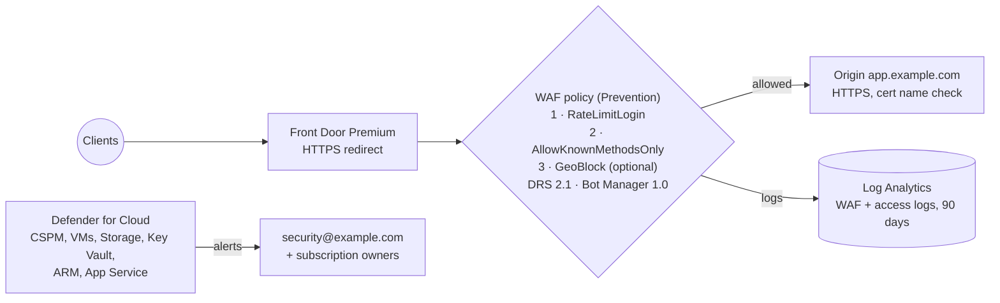

# Azure Front Door WAF and Defender for Cloud as code

The same edge-security baseline written twice, in Terraform ([`terraform/`](terraform)) and Bicep ([`bicep/`](bicep)), for teams that standardize on either.

> **Never deployed.** No Azure subscription, credential or real domain is used. The origin is `app.example.com` and the alert contact is `security@example.com`. CI proves the code is well-formed and that the defaults are the safe ones; it cannot prove behaviour in a real subscription. Standard Defender plans and Front Door Premium are billed services.



## What is configured

| Control | Terraform | Bicep |
|---|---|---|
| Front Door Premium profile, endpoint, origin group with HTTPS health probe, HTTPS-only route | `main.tf` | — (policy only) |
| WAF policy: Prevention mode, body inspection, rate limit on `/login` and `/api/auth`, method allow-list, optional geo block | `main.tf` | `frontdoor-waf.bicep` |
| Managed rules: Microsoft Default Rule Set 2.1 (anomaly scoring), Bot Manager 1.0 | `main.tf` | `frontdoor-waf.bicep` |
| Security policy binding the WAF to every path of the endpoint | `main.tf` | — |
| WAF and access logs to a Log Analytics workspace (90 days) | `main.tf` | — |
| Defender for Cloud plans at Standard tier, security contact | `defender.tf` | `defender.bicep` |

## Run the checks

```bash
cd azure-as-code/terraform
terraform init -backend=false && terraform validate && terraform test     # mock provider, offline

scripts/install-bicep.sh .bin                                              # pinned, sha256-verified
scripts/validate-bicep.sh .bin/bicep azure-as-code/bicep/*.bicep           # build + lint, warnings fail
```

`terraform test` runs nine plan-time tests with `mock_provider`: safe defaults (Prevention, DRS 2.1 blocking, bot rules, body inspection, HTTPS only, certificate checks, WAF on `/*`, logs shipped, Defender plans on Standard), the optional geo rule, and variable validations that reject unsafe input (unknown WAF mode, a non-placeholder e-mail, an unknown Defender plan, lowercase country codes).

Bicep has no test framework, so CI builds and lints both files with warnings treated as errors (unknown properties are only warnings in Bicep), and checks that [`bicep/tests/invalid-property.bicep`](bicep/tests/invalid-property.bicep) **fails**, which proves the gate actually catches schema mistakes.

## Design decisions

- **Prevention by default, Detection selectable.** New policies are usually tuned in Detection for a week; the variable exists for that, but the committed default blocks.
- **DRS 2.1 with anomaly scoring** instead of per-rule blocking: fewer false positives, and it is the current Microsoft-managed rule set.
- **Rate limit per client IP on authentication paths** instead of globally: protects against credential stuffing without throttling the whole site.
- **Logs are part of the baseline.** RB-04 ([`../runbooks/RB-04-web-attack-waf.md`](../runbooks/RB-04-web-attack-waf.md)) depends on WAF logs; a WAF without logs cannot be investigated.
- **Defender plans are a variable.** Plans are billed per resource; the list is explicit so nobody turns on every plan by accident.

## Limitations

- Mock-provider tests assert configuration-derived values only. Azure-side validation (name availability, quotas, plan sub-options) is untested.
- The Bicep files cover the WAF policy and Defender only; the Front Door profile, routes and diagnostics exist only in Terraform.
- No custom domain or managed certificate (they need a real DNS zone).
- `securityContacts` uses the `2023-12-01-preview` API version, the version the Bicep type library offers for that resource.

## References

- Azure Web Application Firewall on Front Door: <https://learn.microsoft.com/azure/web-application-firewall/afds/afds-overview>
- Front Door WAF managed rule sets (DRS 2.1): <https://learn.microsoft.com/azure/web-application-firewall/afds/waf-front-door-drs>
- Front Door WAF rate limiting: <https://learn.microsoft.com/azure/web-application-firewall/afds/waf-front-door-rate-limit>
- Defender for Cloud overview: <https://learn.microsoft.com/azure/defender-for-cloud/defender-for-cloud-introduction>
- Terraform azurerm resources used (3.x docs): `azurerm_cdn_frontdoor_firewall_policy`, `azurerm_cdn_frontdoor_security_policy`, `azurerm_security_center_subscription_pricing`, `azurerm_security_center_contact`: <https://registry.terraform.io/providers/hashicorp/azurerm/3.117.1/docs>
- ARM/Bicep resource references: <https://learn.microsoft.com/azure/templates/microsoft.network/frontdoorwebapplicationfirewallpolicies>, <https://learn.microsoft.com/azure/templates/microsoft.security/pricings>
- Terraform tests and mocking: <https://developer.hashicorp.com/terraform/language/tests>
- Bicep linter: <https://learn.microsoft.com/azure/azure-resource-manager/bicep/linter>
