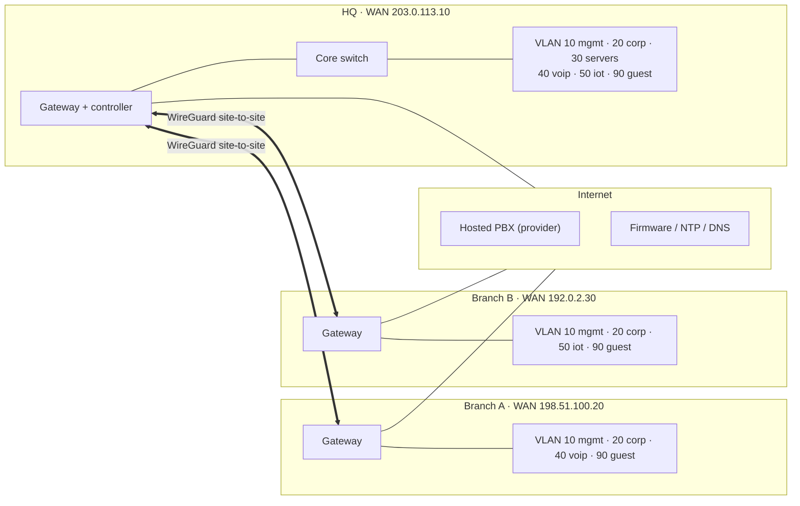

# Network architecture: fictional multi-site, zone-based firewall

> **Fictional.** "Example Co." does not exist. There is no real configuration here: no controller export, no device config, no real IPs. Internal ranges are RFC 1918, WAN addresses are RFC 5737 documentation addresses. The design is written in the vocabulary of UniFi gateways (VLAN networks, zone-based firewall, site-to-site VPN), but it is vendor-neutral enough to map onto any zone-based firewall.

The source of truth is [`policy.yaml`](policy.yaml). [`policy_check.py`](policy_check.py) validates it and answers "is this flow allowed?", and [`tests/test_policy.py`](tests/test_policy.py) pins the invariants below in CI.

```bash
python network-architecture/policy_check.py                                   # validate
python network-architecture/policy_check.py network-architecture/policy.yaml guest servers smb
# guest -> servers (smb): drop [R900]
```

## Topology



Hub and spoke: branches tunnel to HQ, where the servers live. Branch-to-branch traffic is not needed, so there is no tunnel between A and B.

## Addressing

| Site | mgmt (10) | corp (20) | servers (30) | voip (40) | iot (50) | guest (90) |
|---|---|---|---|---|---|---|
| HQ | 10.10.10.0/24 | 10.10.20.0/23 | 10.10.30.0/24 | 10.10.40.0/24 | 10.10.50.0/24 | 10.10.90.0/24 |
| Branch A | 10.20.10.0/24 | 10.20.20.0/24 | — | 10.20.40.0/24 | — | 10.20.90.0/24 |
| Branch B | 10.30.10.0/24 | 10.30.20.0/24 | — | — | 10.30.50.0/24 | 10.30.90.0/24 |

The second octet is the site and the third is the VLAN ID, so an address tells you where it lives during an incident.

## Zone matrix

Rows are sources, columns are destinations. Default is **drop**; cells list what is allowed.

| from \ to | wan | corp | servers | mgmt | vpn |
|---|---|---|---|---|---|
| **corp** | dns, web, ntp (R010) | — | smb, ldaps, kerberos, print, dns (R020) | https-admin, ssh, **it-admins only** (R090) | smb, print, dns (R030) |
| **vpn** | — | — | smb, ldaps, kerberos, print, dns (R040) | — | — |
| **voip** | sip, rtp, ntp, dns (R050) | — | — | — | — |
| **iot** | **drop, logged** (R910) | drop, logged | rtsp, ntp (R060) | drop, logged | — |
| **guest** | dns, web (R070) | drop, logged (R900) | drop, logged | drop, logged | drop, logged |
| **mgmt** | dns, ntp, web (R080) | — | — | — | — |
| **wan** | — | — | — | — | wireguard from site peers only (R100) |

## Invariants enforced by the tests

1. Default action is drop.
2. Every rule has a unique ID and a written reason.
3. No allow rule uses `any` as a service.
4. Guest may only reach the internet. IoT may never reach the internet.
5. Management interfaces are reachable only from the `it-admins` device group.
6. Inbound from the internet is allowed only with a source group (the tunnel peers), and `site-peers` must equal the sites' WAN addresses.
7. VLANs use RFC 1918 space, never overlap across sites, and VLAN IDs are unique per site.
8. WAN addresses are RFC 5737 placeholders, so a real address cannot slip in.

## Design notes

- **Zones over per-VLAN rules.** Rules are written between zones, so adding a VLAN to a zone inherits its policy. This is the model UniFi's zone-based firewall uses, and it keeps the rule count small.
- **Explicit logged denies** for guest and IoT (R900, R910) even though the default is drop: these are the zones where probing is most likely, and a logged deny is what an analyst searches for.
- **Client isolation** on the guest SSID and **no inter-VLAN routing for IoT** except the camera-to-recorder path.
- **Management plane** sits on its own VLAN; admin access comes from two named devices, not from the whole corp VLAN.

## Limitations

- This is a design document plus a policy model. It has not been loaded into a real controller, and `policy_check.py` is not a packet filter: it models first-match rule evaluation between zones, not ports, state or NAT.
- IPv6, wireless settings (WPA3, RADIUS), IDS/IPS profiles and content filtering are described only in prose.

## References

- Ubiquiti, *Zone-Based Firewalls in UniFi*: <https://help.ui.com/hc/en-us/articles/115003173168-Zone-Based-Firewalls-in-UniFi>
- Ubiquiti, *Implementing Network and Client Isolation in UniFi*: <https://help.ui.com/hc/en-us/articles/18965560820247-Implementing-Network-and-Client-Isolation-in-UniFi>
- NIST SP 800-41 Rev. 1, *Guidelines on Firewalls and Firewall Policy*: <https://csrc.nist.gov/pubs/sp/800/41/r1/final>
- RFC 1918, *Address Allocation for Private Internets*: <https://www.rfc-editor.org/rfc/rfc1918>
- RFC 5737, *IPv4 Address Blocks Reserved for Documentation*: <https://www.rfc-editor.org/rfc/rfc5737>
- WireGuard: <https://www.wireguard.com/>
