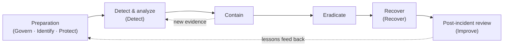

# Incident response runbooks

Generic runbooks for a small organization (the fictional **Example Co.**, ~50 staff, Microsoft 365, GitHub, one Azure subscription, three sites; see [`../network-architecture`](../network-architecture)). They contain no real incident data, no customer names and no real contact details: contacts are roles, and addresses use `example.com`.

| ID | Runbook | Typical trigger |
|---|---|---|
| RB-01 | [Phishing and account compromise](RB-01-phishing-account-compromise.md) | User reports a phish, impossible-travel sign-in, new inbox rule |
| RB-02 | [Secret leaked in a repository](RB-02-leaked-secret.md) | Secret scanning / push protection alert, gitleaks finding |
| RB-03 | [Suspected ransomware](RB-03-ransomware-suspected.md) | Mass file renames, ransom note, EDR alert |
| RB-04 | [Web application attack at the WAF](RB-04-web-attack-waf.md) | Front Door WAF block spike, rate-limit rule firing |

Exercises and templates:

- Tabletop: [TT-01 Leaked CI token](tabletop/TT-01-leaked-ci-token.md)
- [Incident report template](templates/incident-report.md) · [Post-incident review template](templates/post-incident-review.md)

## Lifecycle

The runbooks follow the incident response life cycle of NIST SP 800-61. Rev. 3 (April 2025) maps incident response onto the CSF 2.0 functions; the step headings below are the classic phases because that is how responders think at 2 a.m., and the table shows where each one sits in CSF 2.0.

| Runbook section | NIST SP 800-61r3 / CSF 2.0 |
|---|---|
| Trigger, Detect and analyze | DE.AE (adverse event analysis), RS.MA (incident management) |
| Contain, Eradicate | RS.MI (incident mitigation) |
| Communication | RS.CO (incident response reporting and communication) |
| Recover | RC.RP (incident recovery plan execution) |
| Evidence to keep | RS.AN (incident analysis) |
| Post-incident | ID.IM (improvement) |

## Severity

| Level | Meaning | Response target |
|---|---|---|
| SEV-1 | Business stopped, or confirmed data exposure | Incident lead engaged within 15 min, management informed within 1 h |
| SEV-2 | One system or account compromised, contained to it | Incident lead within 1 h |
| SEV-3 | Suspicious, no confirmed compromise | Next business day |

## Roles

- **Incident lead**: owns decisions and the timeline. One person, named in the ticket.
- **Technical responder**: does the containment and evidence work.
- **Communications**: staff, management and, if needed, customers and regulators. Never the technical responder during SEV-1.
- **Scribe**: keeps the timeline (UTC) in the incident report.

## Conventions

- Every runbook has the same sections in the same order; [`tests/test_runbooks.py`](tests/test_runbooks.py) enforces it.
- Times are UTC. Each action in the timeline records who, what, when and why.
- "Preserve before you change": capture evidence (logs, memory, disk image or at least a snapshot) before wiping or rebuilding, unless the harm of waiting is greater.
